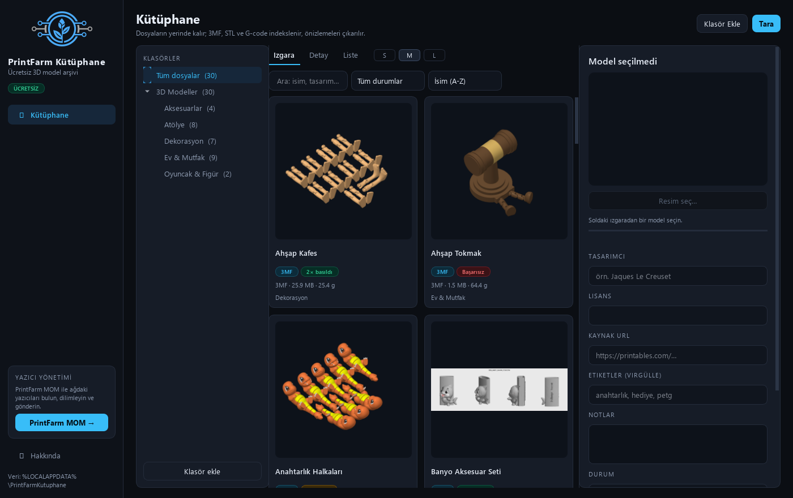
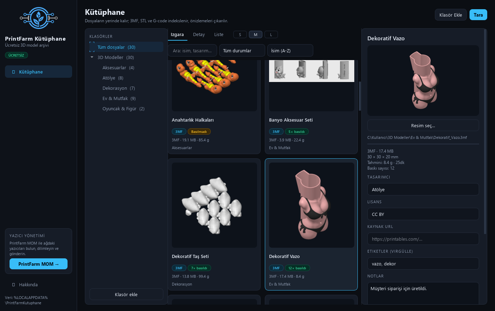
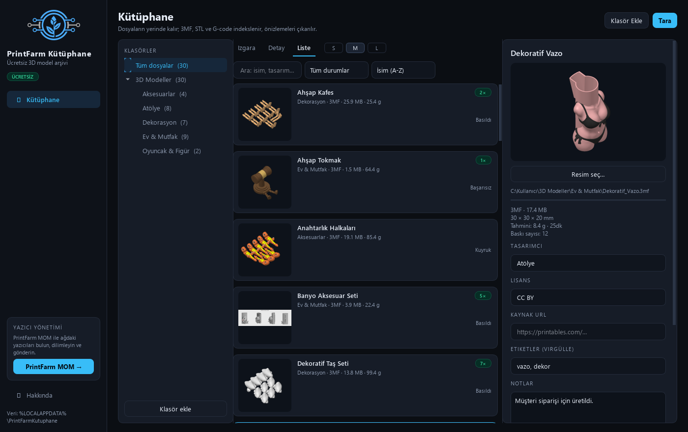

# PrintFarm Kütüphane

**Ücretsiz 3D model arşiviniz** — STL, 3MF ve G-code dosyalarınızı olduğu yerde indeksler; önizlemeleri, etiketleri ve baskı geçmişini tek ekranda toplar.

-0078D6)

[**⬇ İndir**](https://github.com/ozturkweb/printfarm-kutuphane/releases/latest) · [PrintFarm MOM (profesyonel sürüm)](https://github.com/ozturkweb/printfarm-mom/releases/latest)

---

## Neden?

3D baskıyla uğraşan herkesin diskinde yüzlerce, binlerce STL/3MF dosyası dağınık durur. Hangi modeli bastınız, hangisi henüz denenmedi, hangisi hangi tasarımcıya ait — çoğu zaman bunlar klasör adlarından ve dosya isimlerinden anlaşılmaya çalışılır.

PrintFarm Kütüphane bu dağınıklığı **dosyalarınıza dokunmadan** düzenler:

- **Taşımaz, kopyalamaz, silmez.** Dosyalar kendi klasörlerinde kalır; yalnızca indekslenir.
- **3MF içindeki hazır önizlemeleri** otomatik çıkarır — model listesi anında görselleşir.
- İstediğiniz modele **kendi resminizi** atayabilirsiniz.
- Etiket, not, tasarımcı, lisans, kaynak bağlantısı ve baskı geçmişi tek yerde.
- **Ücret yok, deneme süresi yok, hesap yok.** Veriler bilgisayarınızda kalır.

## Özellikler

| | |
|---|---|
| 📁 **Klasör tarama** | Klasör ekleyin, alt klasörleriyle birlikte taransın. Klasör ağacı ve dosya sayaçları. |
| 🖼 **Önizlemeler** | 3MF dosyasının içindeki hazır görsel; yoksa otomatik görselleştirme. |
| 🎨 **Kendi resminiz** | Herhangi bir modele resim atayın, isterseniz otomatik önizlemeye dönün. |
| 🔍 **Arama ve filtre** | İsim, tasarımcı ve notta arama; duruma göre filtre; baskı sayısına, boyuta veya tarihe göre sıralama. |
| 🏷 **Meta veri** | Model başına etiketler, notlar, lisans, kaynak URL'si ve tasarımcı bilgisi. |
| 📊 **Baskı geçmişi** | İstek · Kuyruk · Basılıyor · Basıldı · Başarısız; model başına baskı sayısı. |
| 🗂 **Görünümler** | Izgara, liste ve detay; kart boyutu seçimi. |
| 🔒 **Yerel ve çevrimdışı** | Veriler yerel SQLite veritabanında; internet bağlantısı gerekmez. |

## Ekran görüntüleri

**Kütüphane ızgarası** — önizlemeler, durum rozetleri ve klasör ağacı

**Model detayı** — etiketler, notlar, lisans ve baskı bilgileri

**Liste görünümü** — yoğun klasörlerde hızlı göz atma

## Kurulum

1. [Son sürümü indirin](https://github.com/ozturkweb/printfarm-kutuphane/releases/latest).
2. İki seçenek:
   - **Kurulum:** `PrintFarmKutuphane-Kurulum-1.0.0.exe` dosyasını çalıştırın (yönetici izni gerekmez, kullanıcı klasörüne kurulur).
   - **Taşınabilir:** `PrintFarmKutuphane.exe` dosyasını indirip doğrudan açın. Kurulum gerekmez.
3. İlk açılışta Windows imzasız uygulamalar için *"Windows kişisel bilgisayarınızı korudu"* uyarısı gösterebilir: **Ek bilgi → Yine de çalıştır**.

**Başlarken:** **Klasör Ekle** → 3D dosyalarınızın bulunduğu klasörü seçin → **Tara**. Dosyalarınız yerinde kalır.

## Sistem gereksinimleri

- Windows 10 veya Windows 11 (64-bit)
- Kurulum veya .NET/Python gibi ek çalışma zamanı gerekmez — tek dosya
- İndirme boyutu yaklaşık 95 MB
- İnternet bağlantısı gerekmez

## Veriler nerede?

| Ne | Nerede |
|---|---|
| Ayarlar ve model indeksi | `%LOCALAPPDATA%\PrintFarmKutuphane` |
| Model dosyalarınız | Sizin seçtiğiniz klasörlerde — uygulama onlara dokunmaz |
| Kaldırma | Veri klasörü silinmez; kaldırdıktan sonra da arşiviniz durur |

## Profesyonel sürüm: PrintFarm MOM

Yazıcılarınızı da tek panelden yönetmek isterseniz **PrintFarm MOM** devreye girer: ağdaki 3D yazıcıları otomatik bulur, modeli dilimler, yazıcıya gönderir; kameraları, işleri ve üretim kayıtlarını tek ekranda toplar. İşletme tarafında sipariş, müşteri, stok, kasa ve maliyet hesapları da vardır.

| | PrintFarm Kütüphane | PrintFarm MOM |
|---|---|---|
| Model arşivi ve önizlemeler | ✅ | ✅ |
| Arama, etiket, not, baskı geçmişi | ✅ | ✅ |
| Yazıcıları ağda otomatik bulma | — | ✅ |
| Dilimleme ve yazıcıya gönderme | — | ✅ |
| Canlı yazıcı panelleri ve kamera | — | ✅ |
| İşletme yönetimi (sipariş, stok, kasa) | — | ✅ |
| Ücret | **Ücretsiz** | Profesyonel |

→ **[PrintFarm MOM'u inceleyin](https://github.com/ozturkweb/printfarm-mom/releases/latest)**

## Sık sorulanlar

**Dosyalarım değişir mi veya taşınır mı?**
Hayır. Uygulama yalnızca okur ve kendi veritabanına indeksler. Hiçbir model dosyasını kopyalamaz, taşımaz veya silmez.

**İnternet bağlantısı gerekli mi?**
Hayır. Tamamen çevrimdışı çalışır.

**Lisans veya hesap gerekli mi?**
Hayır. Ne lisans anahtarı ne de kayıt vardır.

**Hangi dosya türleri destekleniyor?**
STL, 3MF ve G-code (`.gcode`, `.gco`, `.g`).

**Arşivim büyük, tarama yavaşlar mı?**
Tarama arka planda sürer; büyük klasörlerde önizlemeler önce gösterilir, ağır analizler isteğe bağlı yapılır.

## Geri bildirim

Hata bildirimi, öneri ve isteklerinizi deponun **Issues** bölümünden veya aşağıdaki iletişim kanallarından iletebilirsiniz.

## İletişim

Öztürk WebTech · [ozturk-web.com](https://www.ozturk-web.com/) · [@ozturkwebtech](https://www.instagram.com/ozturkwebtech/) · iletisim@ozturk-web.com
